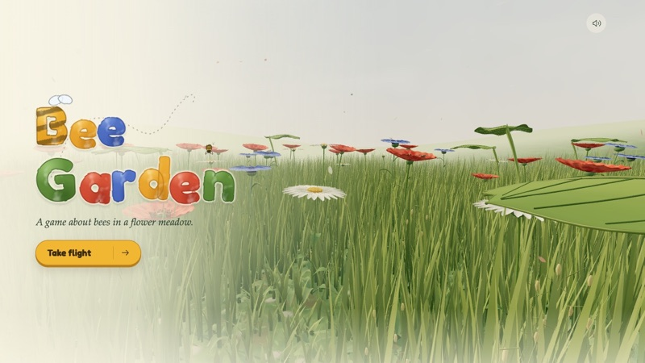
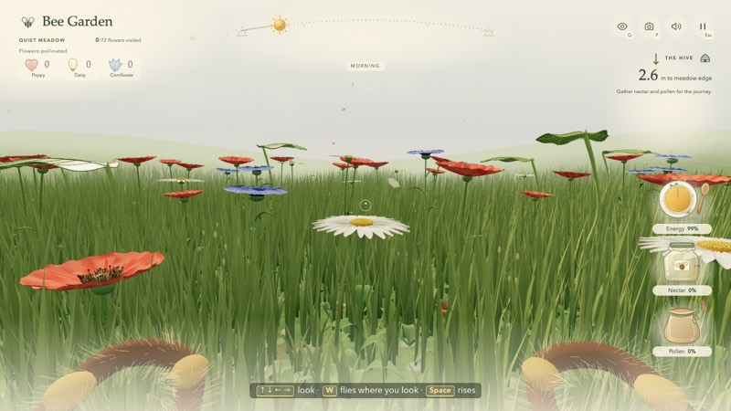
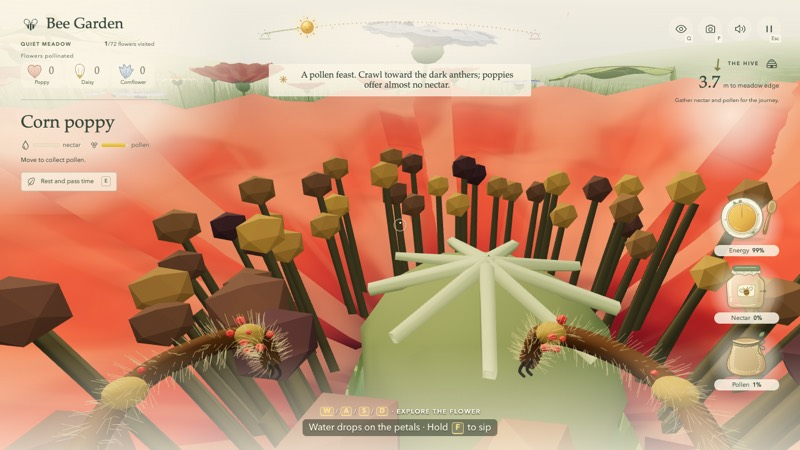

# Bee Garden



A first-person watercolor meadow game. You are a honeybee forager, out for a
summer's day: fly among poppies, daisies and cornflowers, land on their moving
petals, gather nectar and pollen, shelter from the weather, and get home before
dark. A full game is five summers, one queen's reign: what you bring home fills
the hive's stores for the winters between, and whatever you pollinate shapes the
meadow you find the next summer. After the fifth, the Queen says farewell, and
the hive's fate is decided by how the summers went.

**[Play it in your browser](https://arnicas.github.io/bee-garden-game/)** on a
desktop or laptop with a keyboard and mouse, or on a tablet (such as an iPad) held
sideways, with touch controls. It isn't set up for phones yet.

Built by me (arnicas) as critique/direction/director and GPT Astra Extra High as
developer. Claude Opus 5.5 has since joined to help with UX fixes and new work,
including the weather, the creatures and tablet support. (The text hasn't been
fully scrubbed of AI twee yet.)

<p>
  
  
</p>

## How to play

Choose the weather for your five summers (or let nature decide), then start the day on
a daisy. Sip nectar (hold **F**), walk through flowers' centres to gather pollen, and
carry it to another flower of the same kind to pollinate it. Shelter from rain and the
hot sun under a broad leaf or down in the grass, and fly home before dark: once you have
enough, a marker shows the way. Between summers the night passes; then the next summer
begins, its meadow grown from what you pollinated and its weather leaving the ground
wetter or drier. Along the way, find the meadow's small lives (ladybirds, aphids,
butterflies, snails, ants, mushrooms, moths at night) and read bee lore while you rest.

On a computer:

| Action | Keys |
| --- | --- |
| Fly or walk | **W** goes where you look; **S** back; **A**/**D** sideways |
| Look | Arrow keys, or click the meadow to steer with the mouse |
| Rise / take off | **Space** |
| Drop down into the grass | **Ctrl** |
| Land, shelter, rest | **E** when the E cue appears (on a flower, on or under a leaf, in the grass) |
| Sip nectar or water | Hold **F** (or the left mouse button) |
| Bee Vision | **Q** shows flowers you haven't visited, and the ones your pollen matches |
| Head home early | **R** |
| Photo | **P** saves the view as a picture |
| Pause, controls and facts | **Esc** |
| Sound | **M** |

On a tablet, held sideways:

| Action | Touch |
| --- | --- |
| Fly or walk | The stick that appears under your left thumb |
| Look | Drag anywhere on the right |
| Rise / take off | **▲** (it reads **Fly** when you're perched) |
| Drop down into the grass | **▼** |
| Land or shelter | The big **Land** / **Shelter** button, when there's somewhere to land |
| Rest | **Rest and pass time** in the panel at left, once perched |
| Sip nectar or water | Hold **Sip**, which appears when there's something to sip |
| Bee Vision, photo, the way home, sound, pause | The round buttons along the top |

The game's hints show these buttons in place of keys on a tablet, and it draws a little
less grass and detail there to keep the frame rate up.

The [player guide](docs/player-guide.md) has the rest: weather and shelter, the small
lives to find in the meadow, how the summers change, bee lore, Bee and Meadow Facts,
accessibility, and the full rules and numbers.

## Docs

- [Player guide](docs/player-guide.md): how to play, and the full rules and numbers.
- [Developer guide](docs/development.md): setup, source map, tuning, tests and debugging, hosting.
- [Design notes](docs/design/): seasons and moisture, snails, meadow health, pollination across summers.
- [Research](docs/research/): flower facts, the meadow fact check, bee folklore.
- [TODO](TODO.md): open work, and what is done.
- [Showcase video](video/README.md): how the trailer is made.

## Quick start

With Node 22.12 or later and a desktop browser with WebGL2:

```sh
npm ci
npm run dev
```

Then open [the development server](http://127.0.0.1:5188/). To try it on a tablet,
`npm run lan` builds the game and serves it on your home network (it prints the address
to open on the tablet); add `?bench` to the address for a speed check. Builds, tests and
deployment are in the [developer guide](docs/development.md).

## License

Licensed under the [MIT License](LICENSE). Copyright © 2026 Lynn Cherny.
